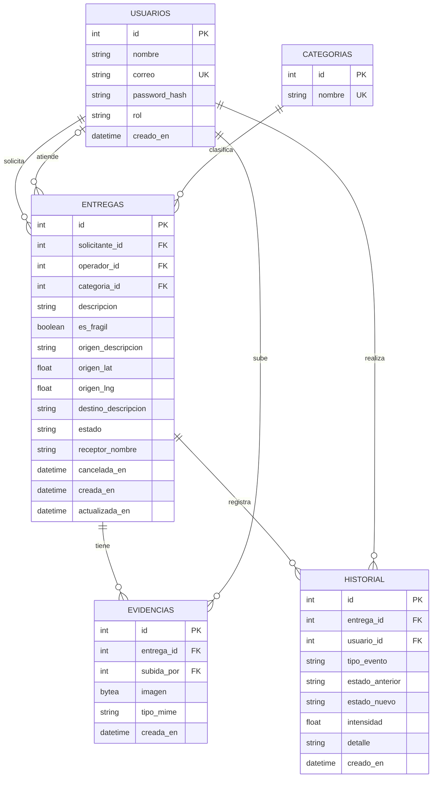

# Modelo entidad-relación

Base de datos central (PostgreSQL) del sistema de entregas universitarias.

## Diagrama

**Cardinalidades.**
- Un usuario **solicita** muchas entregas; cada entrega tiene un solo solicitante.
- Un usuario (operador) **atiende** muchas entregas; cada entrega tiene **cero o un** operador (cero mientras está pendiente).
- Una categoría clasifica muchas entregas.
- Una entrega tiene muchas evidencias y muchos eventos de historial.
- Un usuario sube muchas evidencias y realiza muchos eventos de historial.

## Reglas de integridad (también en la base, como segunda defensa)

El backend valida primero y devuelve un error claro; estas reglas en la base evitan que un fallo del backend deje datos incoherentes.

- **Llaves primarias y foráneas** en todas las relaciones de arriba. `evidencias` e `historial` borran en cascada con su entrega; `usuarios` y `categorias` no se borran si tienen entregas (`RESTRICT`).
- **Únicos:** `usuarios.correo` y `categorias.nombre`.
- **Valores permitidos (`CHECK`):** `rol` ∈ {`usuario`, `operador`}; `estado` ∈ {`pendiente`, `aceptada`, `en_traslado`, `entregada`}; `tipo_evento` ∈ {`creacion`, `edicion`, `cambio_estado`, `impacto`, `cancelacion`}.
- **Regla específica del sistema:** si `estado = 'entregada'`, `receptor_nombre` no puede ser nulo ni vacío.
- **Coherencia de estados:** si `estado` no es `pendiente`, `operador_id` no puede ser nulo.
- **Obligatorios (`NOT NULL`):** solicitante, categoría, descripción, origen, destino, estado y fechas de creación.
- **Índices** en `entregas(solicitante_id)`, `entregas(estado)` e `historial(entrega_id)`.
- **Atomicidad:** el cambio de estado y su renglón de historial se guardan en la **misma transacción** (atomicidad).

## Datos semilla (`db/seed.sql`)

Categorías: `Documento`, `Material`, `Paquete`. Usuarios de prueba: un operador y un usuario, con contraseñas de prueba (guardadas como hash). Sin datos personales de terceros (PDF §16.11).

## Decisiones de diseño

| # | Decisión | Por qué |
| --- | --- | --- |
| 1 | **Origen y destino son texto** (`origen_descripcion`, `destino_descripcion`) y el origen puede llevar **coordenadas** capturadas con el GPS | Evita una tabla y una pantalla de ubicaciones del campus que nadie tendría que administrar. Cumple «indica el lugar de recolección y el destino» y la geolocalización |
| 2 | **Cancelar no es un quinto estado**: se llena `cancelada_en` y se registra un evento `cancelacion`. Solo el solicitante y solo en `pendiente` | Se mantienen los cuatro estados que pide el PDF. Si el profesor prefiere un estado, es agregar un valor |
| 3 | **Los operadores se crean por script** (`db/seed.sql`). El registro público siempre crea rol `usuario` | Si el cliente pudiera elegir su rol, cualquiera se haría operador. El rol nunca viaja en el cuerpo del registro |
| 4 | **Una acción por transición** (`aceptar`, `recoleccion`, `entrega`) en vez de un `PATCH estado` genérico | Cada acción valida su propio permiso y su propia regla. La regla del receptor queda en `entrega` |
| 5 | **Fotos dentro de PostgreSQL** (`bytea`), máximo 2 MB, JPEG o PNG; la app las comprime antes de subirlas | Los discos de los hosts gratuitos son efímeros |
| 6 | **Token firmado** en `Authorization: Bearer <token>` con expiración | Estándar y simple para Flutter. El backend lo valida en cada petición |
| 7 | **Errores con el formato de FastAPI**: `{"detail": "mensaje"}` | Es lo que FastAPI devuelve por defecto; no hay que inventar nada |
| 8 | **Sin paginación en la v1** | Habrá decenas de registros de prueba, no miles. Se documenta como limitación |
| 9 | **Fechas en UTC, ISO 8601** (`2026-11-20T15:32:10Z`) | La app las convierte a hora local al mostrarlas |
| 10 | Nombres de campos en **snake_case** y valores de estado en minúsculas con guion bajo | Un solo estilo en JSON, base de datos y Dart |
